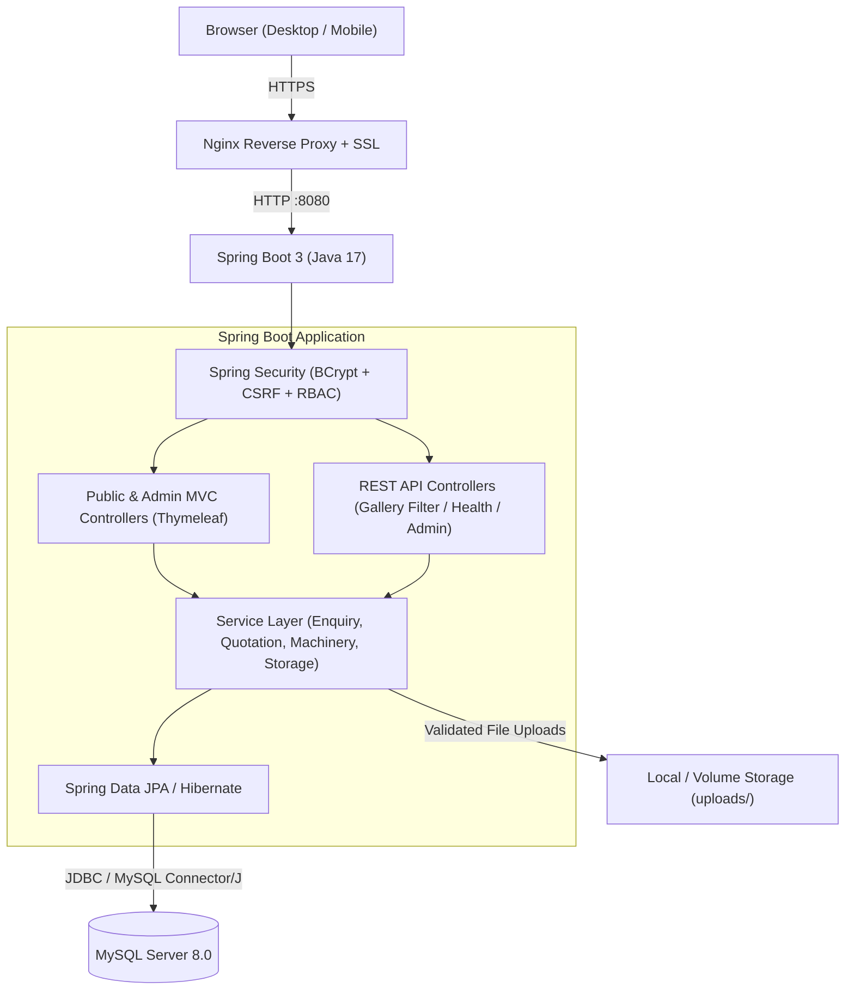

# System Architecture & Implementation Plan

## 1. Recommended Technology Architecture

The platform uses a **modular, server-rendered + REST-enhanced Spring Boot monolith** backed by **MySQL 8**. This keeps deployment simple on a single Always Free VM, ensures strong SEO via server-rendered HTML (Thymeleaf), and cleanly separates public job-work flows, admin management, and future e-commerce modules.

### Free & Open-Source Libraries
- **Backend**: Spring Boot Web, Thymeleaf, Spring Data JPA, Spring Security, Bean Validation (`jakarta.validation`), MySQL Connector/J, Spring Boot Actuator (health checks).
- **Frontend**: Bootstrap 5 (grid/forms/modals), GSAP + ScrollTrigger (CDN, motion-reduced aware), Three.js (lightweight interactive metallic/lathe wireframe accent on desktop with graceful fallback), Google Fonts (`Oswald` / `Inter` or `Space Grotesk`).

---

## 2. Website Sitemap

### Public Pages
- `/` — Homepage (Hero, Category Strip, Machining Showcase, Services, Machinery, Work Gallery, Why Choose Us, Request a Quote, Footer)
- `/about` — About Us & Workshop Capabilities
- `/services` — All Machining Services (filterable by category)
- `/services/{slug}` — Service Detail Page + direct Quote CTA
- `/machinery` — Workshop Machinery & Specifications
- `/our-work` — Completed Job-Work Gallery (filterable by machining type / material)
- `/request-quote` — Dedicated Quotation & Drawing Upload Page
- `/contact` — Direct Contact (Phone, WhatsApp, Email, Map, Contact Form)
- `/products` — Future Product Catalogue preview (hidden/coming-soon toggleable from Admin Website Settings)
- `/sitemap.xml` & `/robots.txt` — Dynamic SEO endpoints

### Admin Dashboard (`/admin`)
- `/admin/login` — Secure Admin Login
- `/admin` — Dashboard Overview (KPIs + recent enquiries/quotations)
- `/admin/services` — Manage Services & Categories
- `/admin/machinery` — Manage Machines & Machine Photos
- `/admin/projects` — Manage Completed Work & Gallery
- `/admin/enquiries` — Manage General Contact Messages
- `/admin/quotations` — Manage Quotation Requests, View Uploaded Drawings, Update Status & Notes
- `/admin/products` — Future Product Catalogue Management (Categories, Products, Images, Inventory)
- `/admin/settings` — Contact Information & Website Settings

---

## 3. Proposed Homepage Wireframe (Industrial Dark/Light Contrast)

1. **Section 1 — Top Navigation**: Sticky dark charcoal/black bar, business logo on left, minimal links (`Home`, `About Us`, `Services`, `Machinery`, `Our Work`, `Contact`), high-contrast `Get a Quote` CTA button on right, responsive mobile drawer.
2. **Section 2 — Hero Section**: Full-bleed dark industrial workshop/lathe photography with gradient vignette, subtle Three.js metallic geometric/spindle accent on desktop, bold uppercase headline (`PRECISION THAT POWERS INDUSTRY.`), concise subheadline, dual CTAs (`Explore Our Services`, `Request a Quote`).
3. **Section 3 — Service Category Strip**: Horizontal dark industrial band (`#0F1115`) with interactive category cards (Lathe Machining, Custom Job Work, Precision Turning, Component Machining, Industrial Manufacturing) featuring arrows and hover elevation.
4. **Section 4 — Machining Showcase**: Split/full-width high-contrast photography block (`PRECISION IN EVERY COMPONENT.`) highlighting metal cutting, turning operations, and tolerances.
5. **Section 5 — Our Services**: Clean 3-column grid of dynamic service cards with image, title, short description, key capability tags, `View Details`, and `Request a Quote`.
6. **Section 6 — Our Machinery**: Industrial dark/silver cards showing each machine's photo, type, model, and confirmed specifications.
7. **Section 7 — Our Work**: Filterable masonry/grid project gallery showing completed components, machining type, and material.
8. **Section 8 — Why Choose Us**: 6-card clean industrial grid highlighting genuine business strengths (Quality-focused work, Reliable job execution, Customer-specific machining, Industrial experience, Timely delivery, Direct communication).
9. **Section 9 — Request a Quote**: Split layout — left side direct contact/WhatsApp/workshop hours; right side structured quotation form with file upload for component photos/drawings.
10. **Section 10 — Footer**: Dark industrial footer with business summary, navigation, services list, address, click-to-call, WhatsApp, email, embedded Google Map, and social links.

---

## 4. Free Hosting Strategy

### Primary Recommended Architecture: Oracle Cloud Infrastructure (OCI) Always Free
- **Compute**: `VM.Standard.A1.Flex` (ARM Ampere) — Always Free tier allows up to 4 OCPUs and 24 GB RAM total (e.g., 2 OCPUs / 12 GB RAM is more than enough for Spring Boot + Nginx).
- **Database**: OCI MySQL HeatWave Always Free (50 GB storage) **or** MySQL Server 8.0 running directly on the OCI VM with automated local backups.
- **Reverse Proxy & SSL**: Nginx + Certbot (Let's Encrypt free HTTPS).
- **Domain**: Free provider subdomain / DuckDNS / No-IP initially, or user's custom domain later.
- **Important Note**: OCI Always Free has **$0 ongoing cost**, though OCI requires a valid payment card during account verification (no charges if you stay strictly within Always Free limits).

### Alternative Zero-Card / Fallback Options (Clearly Distinguished)
- **Render (Free Web Service via Docker)**: $0, no card required, **limitation**: spins down after 15 minutes of inactivity (30–50s cold start) and requires an external database (note: permanent free managed MySQL without a card is rare; most card-free DB tiers are PostgreSQL like Neon/Supabase, whereas Railway offers only a temporary $5 trial credit).
- **Therefore**: OCI Always Free is the primary target for true 24/7 Java + MySQL production hosting without trial expiration.

---

## 5. Development Roadmap (Phases 1–9)

1. **Phase 1 — Research & Planning** *(Current)*: Architecture, sitemap, ER diagram, hosting evaluation, `.gitignore`, initial GitHub push.
2. **Phase 2 — Project Setup**: Spring Boot Maven project (`pom.xml`), MySQL `schema.sql` & `seed.sql`, database connection, health check.
3. **Phase 3 — Frontend Development**: Industrial CSS design system, Thymeleaf layout fragments, all public pages, GSAP/Three.js animations, responsive testing.
4. **Phase 4 — Backend & Database**: JPA entities, repositories, services, enquiry/quotation submission, secure file upload for drawings/photos.
5. **Phase 5 — Admin Dashboard**: Spring Security login, KPI dashboard, full CRUD for services, machinery, projects, enquiries, quotations, settings.
6. **Phase 6 — Future Expansion**: Product catalog, categories, images, and inventory entities/admin UI ready behind a feature toggle.
7. **Phase 7 — Testing**: Integration & controller tests, form validation, upload security tests, responsive & browser checks.
8. **Phase 8 — Deployment**: Dockerfile, production profile, Nginx + HTTPS config, OCI Always Free deployment guide.
9. **Phase 9 — Documentation**: Step-by-step owner's manual (`docs/user-guide.md`) and technical guides.

---

## 6. Git Synchronization Workflow

Every meaningful completed task follows this mandatory cycle:
1. `git status` & `git diff` to inspect exact changes.
2. Run Maven build/tests (`mvn test` / `mvn compile`) to verify no regressions.
3. `git add` only safe, intended files (never `.env`, uploads, or secrets).
4. `git commit -m "<clear imperative message>"`.
5. `git push origin main` (or feature branch -> `main`).
6. Verify `git status` shows clean working tree and synchronized remote.
