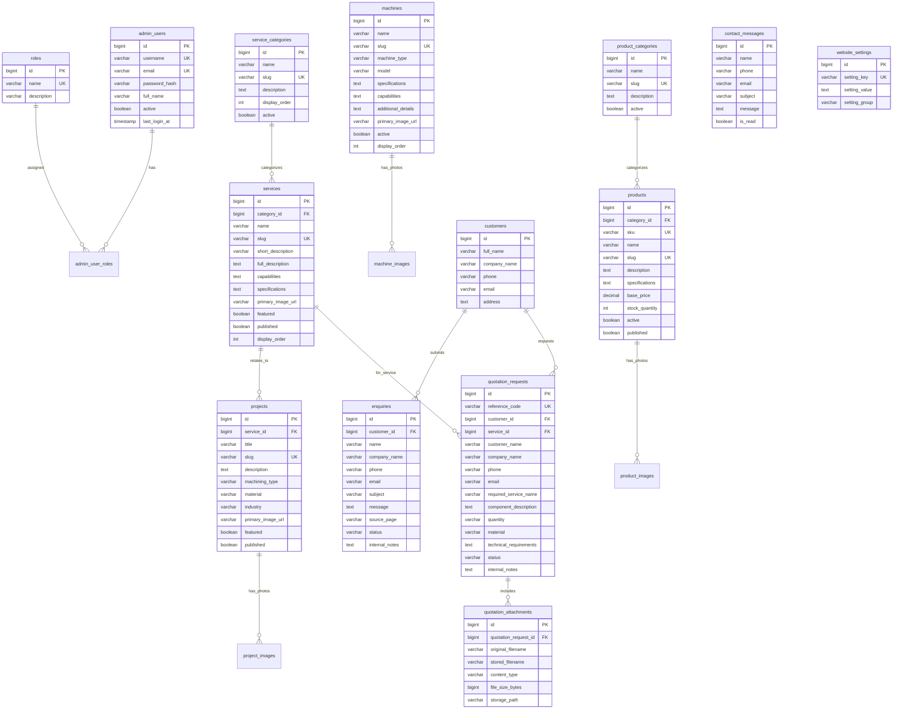

# MySQL Database Design

## Overview

The database is designed for **MySQL Server 8.0** using `utf8mb4` / `utf8mb4_unicode_ci` for full Unicode support, `InnoDB` for ACID transactions and foreign key integrity, and normalized tables covering:
1. **Security & Admin**: `roles`, `admin_users`, `admin_user_roles`
2. **Core Job-Work Catalog**: `service_categories`, `services`, `machines`, `machine_images`, `projects`, `project_images`
3. **Lead & Quotation Management**: `customers`, `enquiries`, `quotation_requests`, `quotation_attachments`, `contact_messages`
4. **Site Configuration**: `website_settings`
5. **Future E-Commerce Expansion**: `product_categories`, `products`, `product_images`

---

## Entity-Relationship Diagram

---

## Key Design Decisions

1. **Audit Timestamps**: Every core table includes `created_at` and `updated_at` managed automatically by MySQL defaults and JPA `@CreationTimestamp` / `@UpdateTimestamp`.
2. **Status Enums**: `enquiries.status` and `quotation_requests.status` use standardized uppercase values (`NEW`, `PENDING`, `CONTACTED`, `QUOTATION_SENT`, `ACCEPTED`, `REJECTED`, `COMPLETED`) with indexes for fast admin filtering.
3. **Safe File Storage**: `quotation_attachments` stores a UUID-based `stored_filename` and relative `storage_path` outside the webroot, while keeping `original_filename` for display in the admin dashboard.
4. **Non-Destructive Future Expansion**: `product_categories`, `products`, and `product_images` are created cleanly in MySQL now, with `products.published = FALSE` by default and an admin toggle in `website_settings` (`ecommerce_enabled = false`).
